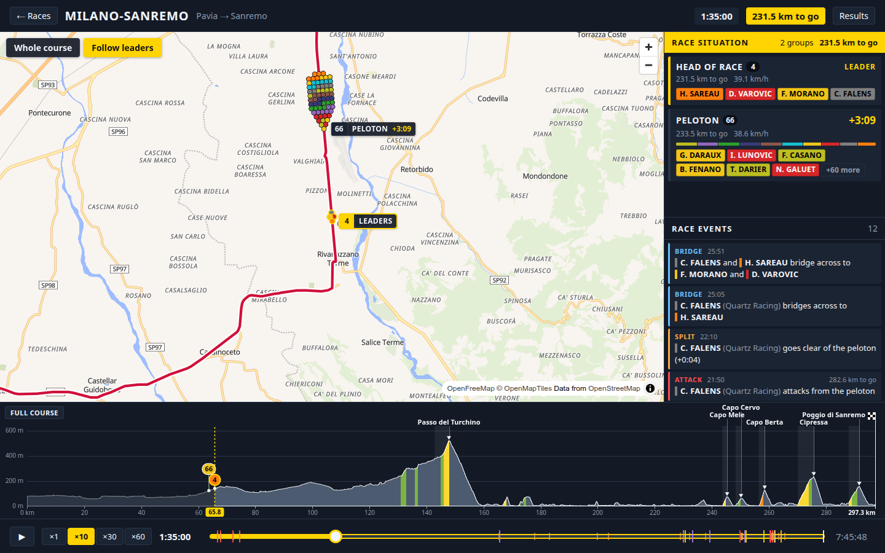
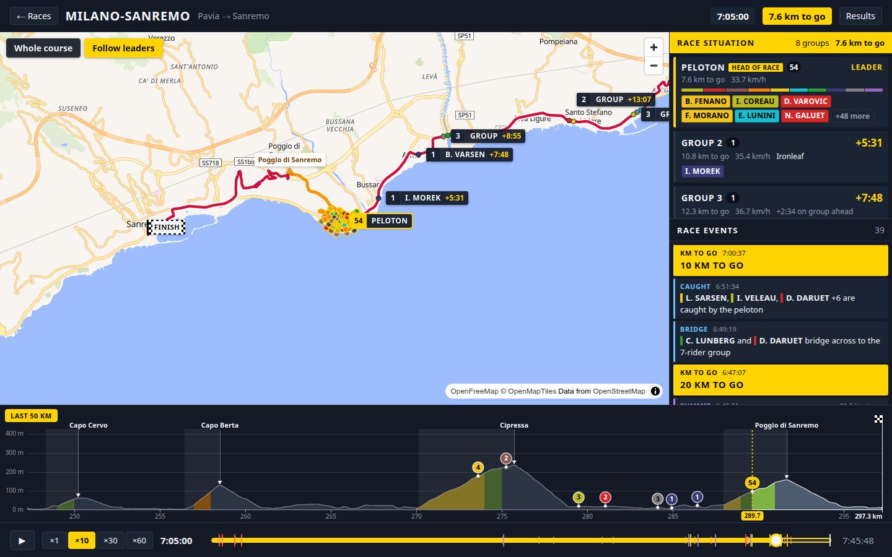
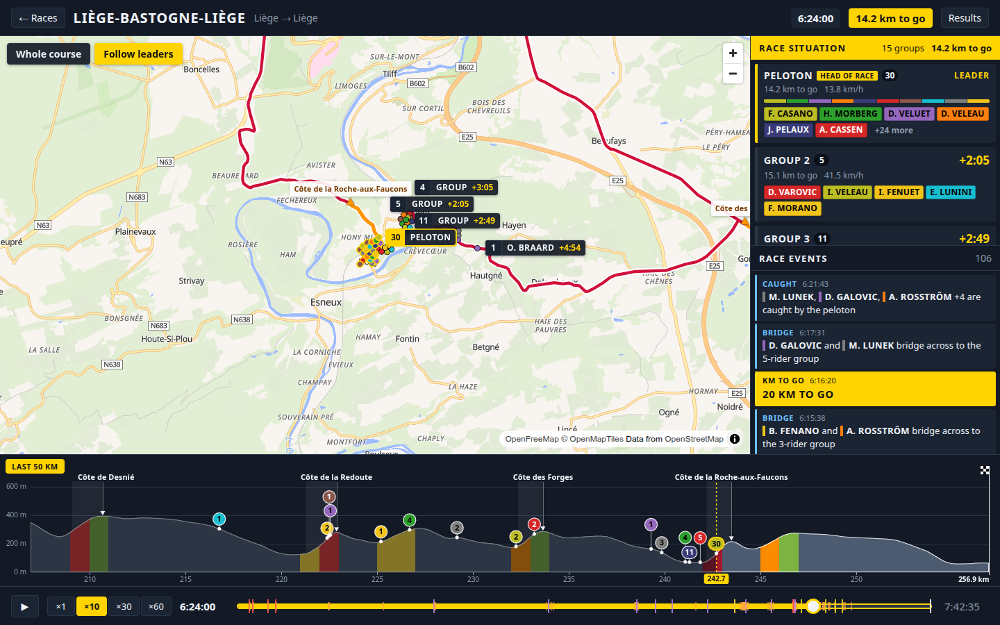
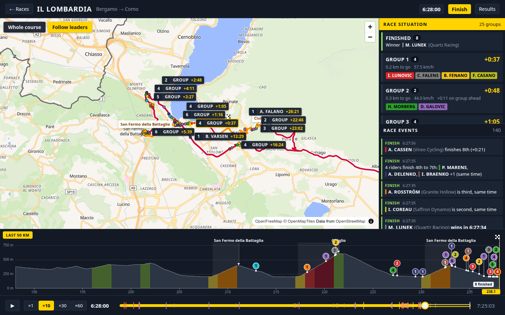
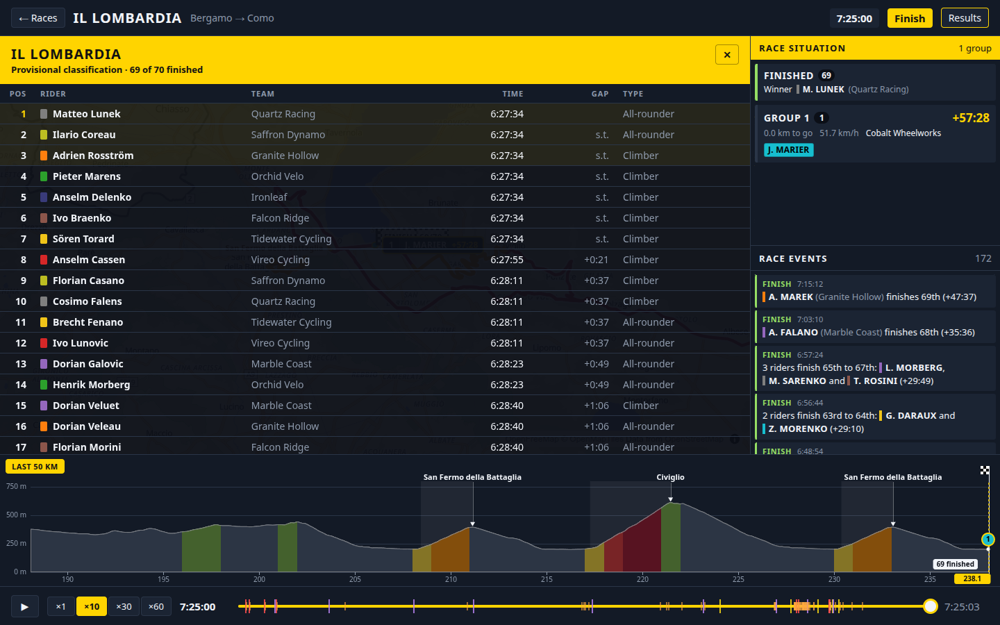
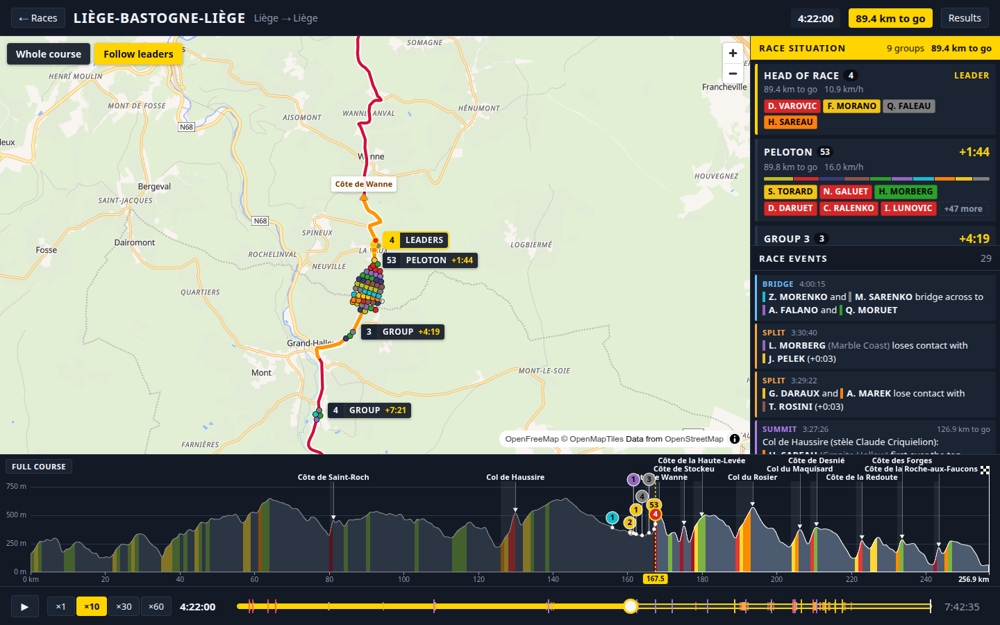

# UCAI frontend (replay v1)

React + Vite + TypeScript (strict), MapLibre GL with OpenFreeMap tiles
(`https://tiles.openfreemap.org/styles/liberty`, no key). See `docs/DESIGN.md` §4 (replay format) and §7.

## Run

```sh
# 1. kernel + 3 races (from the repo root); keeps the kernel on :8080
./gradlew :runner:run --args="--courses milano-sanremo,liege-bastogne-liege,il-lombardia --seed 42 --out replays/ --serve"

# 2. frontend (from frontend/)
npm install
npm run dev          # http://localhost:5173, /api is proxied to http://localhost:8080
```

`UCAI_KERNEL=http://host:port npm run dev` points the proxy at another kernel. Without a kernel, use
**Open a local file** on the race list with `replays/<course>-42.json.gz` (or a plain `.json`).
`#/race/<raceId>` opens a kernel replay directly (e.g. `http://localhost:5173/#/race/race-1`).

| Script | |
|---|---|
| `npm run dev` | Vite dev server with the `/api` proxy |
| `npm run build` | typecheck + production build into `dist/` |
| `npm run typecheck` | `tsc` (no emit) |
| `npm test` | Vitest unit tests (`src/**/*.test.ts`) |

Playback keys: space = play/pause; on the focused timeline ←/→ = ∓1 min (shift: 10 min), Home/End.

Map camera: follows the head of the race by default (TV style); **Whole course** fits the course, a click on a
group label follows that group, dragging the map stops following. Profile: **Full course** / **Last 50 km**
toggle (top left); in the default auto mode it zooms on the last 50 km once the head of the race is 40 km
from the line, groups behind the window are counted at its left edge.

## Screenshots

Seed 42 replays from the runner, 1440×900, served by the kernel (`--serve`) through the Vite proxy.

| | |
|---|---|
|  |  |
| Milano-Sanremo, breakaway established (camera following the leaders, peloton at +3:09) | Milano-Sanremo, Poggio (profile zoomed on the last 50 km) |
|  |  |
| Liège-Bastogne-Liège, Roche-aux-Faucons, 15 groups | Il Lombardia, just after the winner crossed the line |
|  |  |
| Il Lombardia, final classification | `replays/liege-bastogne-liege-42.json.gz` opened as a local file |

Race list: [`race-list.png`](../docs/screenshots/race-list.png).

## Measures

Headless Chrome (Playwright), 1440×900, AMD Renoir iGPU through ANGLE/GL, kernel and Vite on the same machine.

| | Milano-Sanremo | Liège-Bastogne-Liège | Il Lombardia |
|---|---|---|---|
| Replay download (gzip on the wire → JSON) | 1.2 MB → 11.1 MB | 1.4 MB → 11.8 MB | 1.3 MB → 11.0 MB |
| Fetch / gunzip + JSON.parse + decode / `ReplayModel` | 56 / 76 / 10 ms | 72 / 91 / 10 ms | 68 / 77 / 10 ms |
| Click "Watch replay" → replay view rendered (production build) | 370–420 ms | 330–340 ms | 330 ms |
| `snapshotAt` (mean over the race) | 86 µs | 14 µs | 60 µs |
| ×60 playback, production build (10 s of rAF, finale) | 60 fps, p95 16.7 ms | 60 fps, p95 16.8 ms | 60 fps, p95 16.8 ms |
| ×60 playback, dev server (finale) | 60 fps | 52 fps, p95 33 ms | 51 fps, p95 33 ms |
| JS heap while playing | 30–60 MB | 30–75 MB | 30–75 MB |

A local `.json.gz` file opens in ≈ 420 ms. With software WebGL (SwiftShader, the headless default) MapLibre alone
caps playback at 13–17 fps: measure with a real GPU (`--ignore-gpu-blocklist --use-angle=gl-egl`).

## Layout

```
src/
  api/        types.ts (DTO mirror), decode.ts (compact arrays), client.ts (REST + replay loading)
  replay/     source.ts (RaceSource seam + snapshot types), model.ts (ReplayModel), clock.ts (playback),
              meta.ts (RaceMeta, team colors, rider lookups), course.ts (position on course),
              events.ts (event labels/colors/descriptions), format.ts (time, gap, km), fixtures.ts (test replay)
  app/        RaceList.tsx, ReplayView.tsx (fixed layout, one slot per view)
  views/      one file per slot (see below), each with its own optional views/<View>.css
  App.tsx     race list → replay view
  styles.css  theme variables (--bg, --panel, --panel-2, --line, --text, --muted, --accent, --accent-text) and layout
```

Ownership for parallel work: each view agent edits only `views/<View>.tsx` (+ its own `views/<View>.css`,
tests and helper files named `views/<View>.*`). `src/replay`, `src/api`, `src/app`, `App.tsx` and
`styles.css` are shared — don't change their exports; add view-local helpers instead.

## Data source seam

Views never see frames: they get a `RaceMeta` (static) and a `RaceSnapshot` (state at playback time `t`) from a
`RaceSource`. `ReplayModel` is the replay implementation; a live SSE source will implement the same interface.

```ts
interface RaceSource {
  kind: 'replay' | 'live';
  meta: RaceMeta;
  startT: number; endT: number;            // race-time range, s
  events: readonly RaceEvent[];            // all known, sorted by tick
  results: Classification | null;
  snapshotAt(t: number): RaceSnapshot;     // clamped to [startT, endT]
  eventsUntil(t: number): readonly RaceEvent[]; // tick <= t; same array instance while unchanged
  subscribe(listener: () => void): () => void;  // live data arrival (replay: never fires)
}

interface RaceSnapshot {
  t: number;
  riders: RiderState[];        // meta.riders order
  groups: GroupState[];        // on the road, front to back
  finishedRiderIds: number[];  // by finishing position
  headDistM: number;           // leading rider (finished or not)
  kmToGo: number;
  raceFinished: boolean;
}

interface RiderState {
  riderId: number; teamId: string; index: number;  // index in meta.riders
  distM: number; speed: number;                    // linear between frames (m, m/s)
  groupId: number; rankInGroup: number;            // steps; groupId 0 = finished, rank = position
  finished: boolean; position: number | null;
  lat: number; lon: number; eleM: number;          // on the course polyline at distM
}

interface GroupState {
  id: number; riderIds: number[] /* front to back */; size: number;
  headDistM: number; tailDistM: number; headRiderId: number;
  lat: number; lon: number; eleM: number;          // head of the group
  gapToHeadS: number;   // s since the race leader (the winner once someone finished) passed headDistM
  gapToAheadS: number;  // s since the head of the group ahead passed headDistM
  kmToGo: number;
}
```

Gaps are real time gaps from the frames: the pass time of the reference rider at the group's head distance is
binary-searched in that rider's (non-decreasing) distances and interpolated between frames.

`ReplayModel` also exposes `frameIndexAt(t)`, `distAt(riderIndex, t)` and `passTime(riderIndex, distM)`.

`RaceMeta`: `race`, `course` (decoded points `{lat, lon, eleM, distM}`, `climbs`), `teams`, `riders`, `climbs`,
`teamById`, `riderById`, `riderIndex`. Helpers in `replay/meta.ts`: `teamColor(meta, teamId)`,
`riderColor(meta, riderId)`, `riderTeam`, `rider`, `team`, `riderName`, `riderShortName` (`G. VELOVIC`),
`textColorOn(hex)` (black/white for text on a team color), `UNKNOWN_COLOR`.
`replay/course.ts`: `positionAt(points, distM)`, `pointIndexAt(points, distM)`.
`replay/events.ts`: `EVENT_LABELS`, `EVENT_COLORS`, `describeEvent(meta, e)`, `TIMELINE_EVENT_TYPES`.
`replay/format.ts`: `formatRaceTime`, `formatGap`, `formatKm`, `formatSpeed`, `formatGrade`.

### Playback clock

`PlaybackClock(startT, endT, speed = 10)`: `getState()` → `{t, playing, speed, startT, endT}`, `subscribe`,
`play` (restarts from `startT` when at the end), `pause`, `toggle`, `setSpeed(1|10|30|60)`, `seek(t)`,
`setRange(startT, endT)`, `advance(wallSeconds)` (driven by `requestAnimationFrame` while playing).
Hooks: `usePlaybackClock(startT, endT)` (one clock per component instance), `usePlayback(clock)`.
`PLAYBACK_SPEEDS = [1, 10, 30, 60]`.

## Views (props contract)

Every view fills its slot box (`position: relative`, `overflow: hidden`, sized by the grid) and must handle
being re-rendered every animation frame while playing (snapshot changes; `meta` never changes for a race).

| View | Props | Slot |
|---|---|---|
| `MapView` | `{ meta: RaceMeta; snapshot: RaceSnapshot }` | big left area |
| `ProfileView` | `{ meta: RaceMeta; snapshot: RaceSnapshot }` | full-width strip, 190 px high |
| `GroupsPanel` | `{ meta: RaceMeta; snapshot: RaceSnapshot }` | right column, top |
| `EventsList` | `{ meta: RaceMeta; events: readonly RaceEvent[] /* tick <= t, chronological */; t: number }` | right column, bottom |
| `ResultsTable` | `{ meta: RaceMeta; results: Classification \| null; t: number; onClose: () => void }` | overlay over the map (header "Results" button, opens itself when the race ends) |
| `PlaybackBar` | `{ meta: RaceMeta; clock: PlaybackClock; state: PlaybackState; events: readonly RaceEvent[] /* all */ }` | bottom bar (implemented) |

`ResultsTable` should only list riders with `timeS <= t`, so scrubbing back hides later finishers.
